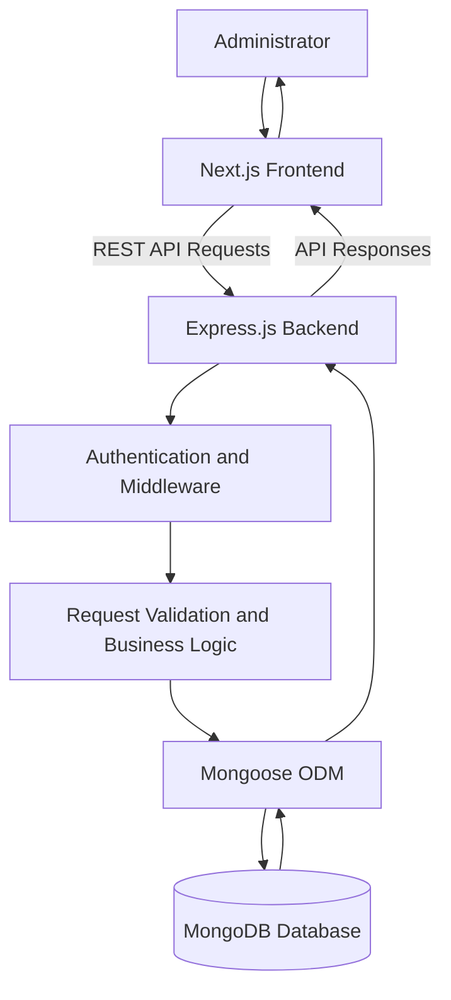

# Doctor Tracker

A full-stack doctor and patient management system designed to simplify healthcare record management through a centralized administrative dashboard.

Doctor Tracker provides an integrated platform for managing doctors, patients, and their associations, with secure authentication, dashboard analytics, search and filtering, and customizable user preferences.

## Live Application

| Resource | Link |
|---|---|
| Frontend Application | [Doctor Tracker](https://doctor-tracker-blond.vercel.app) |
| Backend API | [Backend Service](https://doctor-tracker-twjn.onrender.com) |
| API Health Check | [Health Endpoint](https://doctor-tracker-twjn.onrender.com/api/health) |

## Application Features

- **Admin Authentication:** Secure administrative login and protected application access.
- **Dashboard Analytics:** Overview of total doctors, total patients, patient allocation, and registration statistics.
- **Doctor Management:** Create, view, update, search, and manage doctor records.
- **Patient Management:** Create, view, update, delete, search, and manage patient records.
- **Doctor-Patient Association:** Manage relationships between doctors and their assigned patients.
- **Search and Filtering:** Find doctor and patient records using relevant search criteria and filters.
- **Global Search:** Search across available doctor and patient records.
- **Pagination:** Navigate records through server-side pagination.
- **Theme Preferences:** Light and dark theme support.
- **Language Preferences:** English and Bangla interface support.
- **Responsive Interface:** Layout designed for desktop and mobile devices.
- **REST API Integration:** Centralized communication between the frontend and backend.

## Application Screenshots

Add screenshots of the actual deployed application in `docs/screenshots/` and update the paths below if your filenames differ.

### Dashboard


### Doctor Management


### Patient Management


### Mobile Interface


## Technology Stack

### Frontend

| Technology | Purpose |
|---|---|
| Next.js | Frontend framework |
| React | Component-based user interface |
| TypeScript | Static typing |
| Tailwind CSS | Responsive styling |
| Recharts | Dashboard data visualization |
| Lucide React | Interface icons |

### Backend

| Technology | Purpose |
|---|---|
| Node.js | JavaScript runtime |
| Express.js | REST API framework |
| TypeScript | Static typing |
| MongoDB | NoSQL database |
| Mongoose | MongoDB object modeling |
| JSON Web Token (JWT) | Authentication |
| Zod | Request validation |

## Project Structure

```text
Doctor-tracker/
├── frontend/
│   ├── public/
│   ├── src/
│   ├── package.json
│   └── README.md
│
├── backend/
│   ├── src/
│   ├── package.json
│   ├── .env.example
│   └── README.md
│
├── .gitignore
└── README.md
```

## Prerequisites

Before installing the application, ensure that you have:

- [Node.js](https://nodejs.org/) installed.
- npm (included with Node.js).
- A MongoDB database, either locally or through [MongoDB Atlas](https://www.mongodb.com/atlas).
- [Git](https://git-scm.com/) installed.

## Installation and Setup

### 1. Clone the Repository

```bash
git clone https://github.com/tasfahim/Doctor-tracker.git

cd Doctor-tracker
```

### 2. Configure the Backend

Navigate to the backend directory:

```bash
cd backend
```

Install dependencies:

```bash
npm install
```

Create a `.env` file in the backend directory using `.env.example` as a reference.

Configure the following environment variables:

| Variable | Description |
|---|---|
| `PORT` | Backend server port |
| `NODE_ENV` | Application environment |
| `CLIENT_URL` | Frontend origin allowed by CORS |
| `MONGODB_URI` | MongoDB connection string |
| `JWT_SECRET` | Secret used for JWT authentication |

Use appropriate local development values. Never commit actual credentials or secrets to GitHub.

Start the backend development server:

```bash
npm run dev
```

The backend runs locally at:

```text
http://localhost:5000
```

Backend health check:

```text
http://localhost:5000/api/health
```

### 3. Configure the Frontend

Open a separate terminal and navigate to the frontend directory:

```bash
cd Doctor-tracker/frontend
```

Install dependencies:

```bash
npm install
```

Create a `.env.local` file in the frontend directory and configure:

```env
NEXT_PUBLIC_API_URL=http://localhost:5000/api
```

This variable specifies the backend API base URL used by the frontend.

Start the frontend development server:

```bash
npm run dev
```

Open the application in your browser:

```text
http://localhost:3000
```

## Available Scripts

### Frontend

Run these commands from the `frontend` directory.

| Command | Description |
|---|---|
| `npm run dev` | Start the development server |
| `npm run build` | Build the production application |
| `npm run start` | Start the production server |
| `npm run lint` | Run ESLint |

### Backend

Run these commands from the `backend` directory.

| Command | Description |
|---|---|
| `npm run dev` | Start the development server |
| `npm run build` | Compile TypeScript |
| `npm run start` | Start the production server |

## System Architecture

Doctor Tracker follows a separated frontend and backend architecture. The frontend communicates with the backend through REST API requests, while the backend handles authentication, validation, business logic, and database operations.



### Application Components

**Frontend**

- Built with Next.js, React, and TypeScript.
- Provides dashboard, doctor management, and patient management interfaces.
- Handles user interactions, search, filtering, pagination, and preferences.
- Communicates with the backend through REST API endpoints.

**Backend**

- Built with Node.js, Express.js, and TypeScript.
- Handles authentication and application business logic.
- Validates incoming requests.
- Performs database operations through Mongoose.
- Returns structured API responses to the frontend.

**Database**

- MongoDB stores application records.
- Mongoose provides schema-based data modeling and database interaction.

## Backend Architecture

The backend follows a modular structure:

- **Configuration:** Database connection and application configuration.
- **Models:** MongoDB data models for doctors, patients, and users.
- **Routes:** REST API endpoints and request handling.
- **Application:** Express middleware, security configuration, and error handling.
- **Server:** Database initialization and server startup.

## Technical Decisions

### 1. Separate Frontend and Backend

The application uses Next.js for the frontend and a standalone Express.js backend for API operations.

This separation provides a clear division of responsibilities, improves maintainability, and allows the frontend and backend to be developed and deployed independently.

### 2. MongoDB with Mongoose

MongoDB was selected to manage doctor, patient, and user records. Mongoose provides schema definitions, validation, and structured database interaction.

This approach keeps database operations organized and supports the application's record-management requirements.

## Security and Reliability

The application incorporates the following security and reliability measures:

- JWT-based authentication.
- Password hashing.
- Helmet security middleware.
- CORS origin configuration.
- Rate limiting.
- Request validation.
- Centralized error handling.
- MongoDB connection management.
- Protection against deleting doctors with assigned patients.

## Deployment

The application is deployed using separate frontend and backend hosting services.

| Component | Platform |
|---|---|
| Frontend | Vercel |
| Backend | Render |
| Database | MongoDB Atlas |

The frontend communicates with the deployed backend through the configured `NEXT_PUBLIC_API_URL` environment variable.

Production environment variables and credentials are configured through the respective hosting platforms and are not stored in the public repository.

## Repository Links

- **Main Repository:** [tasfahim/Doctor-tracker](https://github.com/tasfahim/Doctor-tracker)
- **Frontend Repository:** [tasfahim/doctor-tracker-frontend](https://github.com/tasfahim/doctor-tracker-frontend)
- **Backend Repository:** [tasfahim/doctor-tracker-backend](https://github.com/tasfahim/doctor-tracker-backend)

The frontend and backend repositories are maintained separately as independent project backups. The main repository contains the integrated full-stack application.
